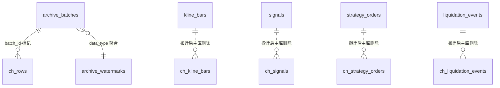
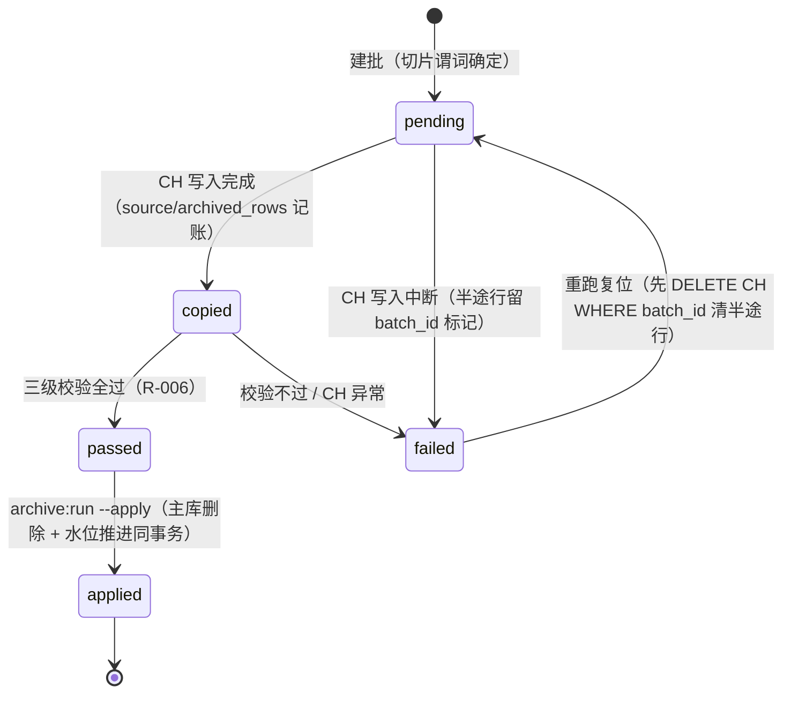

# Data Model: ClickHouse 历史归档

**Feature**: 004-clickhouse-historical-archive | **Date**: 2026-10-18
**来源**: spec Key Entities + 四表 migrations 实测列结构 + research R-003/R-004/R-010。
**存储分层**: MySQL 8.4（热数据 + 账目）+ ClickHouse 单节点（冷数据）。所有时间 UTC（constitution II）。

---

## 1. 实体总览

| 实体 | 层 | 角色 |
|---|---|---|
| kline_bars / signals / strategy_orders / liquidation_events | MySQL（既有，零改动） | 热数据源 |
| archive_batches / archive_watermarks | MySQL（新增） | 归档账目与水位 |
| ch_kline_bars / ch_signals / ch_strategy_orders / ch_liquidation_events | ClickHouse（新增） | 冷数据 |

---

## 2. MySQL 新增账目表

### archive_batches（归档批次，spec Key Entities「归档批次」落地）

| 字段 | 类型 | 约束 | 说明 |
|---|---|---|---|
| id | bigint unsigned PK | 自增 | 同时作为 CH 行 `batch_id` 标记 |
| data_type | varchar(32) | enum 语义：kline_bar / signal / strategy_order / liquidation_event | 数据类型（PHP 侧用 enum `ArchiveDataType`，DB 存字符串） |
| time_from | timestamp(0) | not null, UTC | 批次切片左界（含） |
| time_to | timestamp(0) | not null, UTC | 批次切片右界（不含），copy/verify/delete 共用谓词 `time >= from AND time < to` |
| source_rows | bigint unsigned | not null | copy 阶段主库实际读出行数 |
| archived_rows | bigint unsigned | not null, default 0 | copy 阶段实际写入 CH 行数 |
| verify_status | varchar(16) | not null, default 'pending' | pending / passed / failed |
| applied_at | timestamp(0) | nullable | 主库删除完成时间戳；非 null = 该批已从主库移除 |
| failed_reason | text | nullable | 最近一次失败原因（verify 不过 / CH 不可用 / 行数不符） |
| created_at / updated_at | timestamp(0) | | |

索引：`uniq_batch_type_range (data_type, time_from, time_to)`（防同切片重复建批）；`idx_batch_type_status (data_type, verify_status)`；`idx_batch_type_applied (data_type, applied_at)`。

**校验规则**（FR-005 落地）：`applied_at` 只允许写入 `verify_status = 'passed'` 且 `source_rows = archived_rows` 的批次——违反即异常 abort（DB 层不设 CHECK，由 ArchivePipeline 事务内守卫 + 集成测试断言）。

**状态机**：

注：`--apply` 只处理 `verify_status = 'passed'` 批次（无论本命令新建还是历史遗留）；dry-run（默认）止步于 copied/passed。

### archive_watermarks（归档水位，spec Key Entities「归档水位」落地）

| 字段 | 类型 | 约束 | 说明 |
|---|---|---|---|
| id | bigint unsigned PK | | |
| data_type | varchar(32) | unique | 每类型单行 |
| copied_watermark | timestamp(0) | not null, default '1970-01-01 00:00:00' | 最大 copied 批次 time_to（进度展示） |
| applied_watermark | timestamp(0) | not null, default '1970-01-01 00:00:00' | 最大 applied 批次 time_to（**HistoricalQuery 路由基准**，R-007） |
| updated_at | timestamp(0) | | |

**推进规则**：两水位只增不减，与批次完成在同一事务内推进（applied 水位与主库删除同事务——R-010，路由正确性根基）。

**派生量**（FR-009 状态查询，不做持久化）：待归档量 = `COUNT(*) WHERE 时间列 >= copied_watermark AND 时间列 < now - retention_days`。

---

## 3. ClickHouse 冷数据表（DDL 唯一事实源 = contracts/clickhouse-schema-contract.md，此处记模型语义）

### 公共列约定（四表统一）

| 列 | 类型 | 说明 |
|---|---|---|
| id | UInt64 | 主库原 id，保留（跨层对账 + 去重键） |
| batch_id | UInt64 | 来源批次 id（archive_batches.id），幂等清理键（R-003） |
| archived_at | DateTime('UTC') | 搬迁写入时间戳（审计） |

幂等键 = `batch_id`（重跑清理）；对账键 = `(自然键, id)`；查询排序键 = `(时间列, id)`。

### ch_kline_bars（public 数据）

| MySQL 列 | CH 类型 | 备注 |
|---|---|---|
| exchange_code / symbol / interval | LowCardinality(String) | |
| open_time / close_time | DateTime('UTC') | 时间轴 = open_time |
| open/high/low/close/volume/quote_volume | Decimal(20,8) | 字符串读写（R-004） |
| trades_count | UInt32 | |
| created_at / updated_at | DateTime('UTC') | 保真搬迁 |

`PARTITION BY toYYYYMM(open_time)`；`ORDER BY (exchange_code, symbol, interval, open_time, id)`。
主库唯一键 `uniq_kb(exchange_code, symbol, interval, open_time)` 在 CH 侧由先删后插幂等机制等价保障。

### ch_signals（tenant 数据，visibility=tenant）

| MySQL 列 | CH 类型 | 备注 |
|---|---|---|
| tenant_id | UInt64 | 隔离强制列（R-008） |
| subscription_id | UInt64 | |
| symbol / interval | LowCardinality(String) / LowCardinality(String) | |
| direction / source | LowCardinality(String) | 原枚举字符串值 |
| entry_price / exit_price / stop_loss | Decimal(20,8) | |
| confidence | Decimal(5,2) | |
| rationale | String（null→''） | |
| raw_payload | String | 原 JSON 串存，不解析 |
| triggered_at | DateTime('UTC') | 时间轴 |
| created_at / updated_at | DateTime('UTC') | |

`PARTITION BY toYYYYMM(triggered_at)`；`ORDER BY (tenant_id, symbol, triggered_at, id)`。

### ch_strategy_orders（tenant 数据，visibility=tenant）

| MySQL 列 | CH 类型 | 备注 |
|---|---|---|
| tenant_id | UInt64 | 隔离强制列 |
| strategy_instance_id | UInt64 | |
| exchange_order_id / client_order_id | Nullable(String) / String | exchange_order_id 可空保真 |
| symbol | LowCardinality(String) | |
| side / type / status | LowCardinality(String) | 原枚举字符串值 |
| quantity / price / stop_price / filled_qty / avg_fill_price / fee | Decimal(20,8)；可空列（price/stop_price/avg_fill_price）→ `Nullable(Decimal(20,8))` 保真（null↔null，无哨兵歧义） | |
| leverage | Nullable(UInt16) | |
| reduce_only | UInt8 | |
| error_message | String（null→''） | |
| placed_at / filled_at | Nullable(DateTime('UTC')) | 可空保真，null=无 |
| created_at / updated_at | DateTime('UTC') | 时间轴 = created_at（非空列，R-005） |

`PARTITION BY toYYYYMM(created_at)`；`ORDER BY (tenant_id, created_at, id)`。
时间轴选 created_at 而非 placed_at 的原因：placed_at 可空，切片谓词与删除谓词必须建立在非空列上（R-005 纯时间片语义）。

### ch_liquidation_events（public 数据）

| MySQL 列 | CH 类型 | 备注 |
|---|---|---|
| exchange_code / symbol | LowCardinality(String) | |
| side | LowCardinality(String) | BUY/SELL 原值 |
| price / qty | Decimal(20,8) | |
| value_usd | Decimal(20,2) | |
| event_ts | DateTime('UTC') | 时间轴 |
| exchange_event_id | String（null→''） | 幂等键保真 |
| created_at / updated_at | DateTime('UTC') | |

`PARTITION BY toYYYYMM(event_ts)`；`ORDER BY (symbol, event_ts, id)`。

---

## 4. 契约层实体（PHP，非持久化）

### ArchiveDataType（enum）

`KlineBar` / `Signal` / `StrategyOrder` / `LiquidationEvent` —— 各自绑定 `ArchiveType` 策略实现（时间轴列、CH 表名、visibility、行映射、规范化串列序）。

### HistoricalQueryRequest（不可变 DTO）

| 字段 | 类型 | 规则 |
|---|---|---|
| dataType | ArchiveDataType | 必填 |
| from / to | DateTimeImmutable（UTC） | 必填，from < to；[from, to) 左闭右开 |
| symbol | ?string | 可选等值过滤（kline 场景配合 exchange/interval） |
| exchangeCode / interval | ?string | 仅 KlineBar 允许非空，其余类型传值抛 InvalidArgumentException |
| tenantId | 无此字段 | **物理不存在**（R-008 隔离下沉；tenant 类型由 TenantContext 注入） |
| pageSize | int | 默认 1000，上限 config `archive.query_max_rows`（超限抛异常，FR-011） |
| cursor | ?string | 上页结果返回的不透明游标（(时间列, id) base64） |

### HistoricalQueryResult（不可变 DTO）

| 字段 | 类型 | 说明 |
|---|---|---|
| rows | list<array<string,string>> | 行以「列名 => 字符串」字典序时间排序；Decimal/时间/整数全字符串化（R-004，消费端 bcmath 直用） |
| nextPageCursor | ?string | null = 无更多页 |
| servedFrom | enum(self::HOT/COLD/MERGED) | 观测字段：本次数据实际来自哪层（测试/运维用，不参与业务逻辑） |

### 归档批次报告（archive:run / archive:verify 输出 DTO）

batch id、data_type、时间范围、source_rows、archived_rows、verify_status、三级校验明细（行数/哈希和/抽样）、可删范围摘要（dry-run 模式）、删除结果（apply 模式）。

---

## 5. 生命周期与级联语义

- **MySQL 热行**：正常业务写入/更新；切片进入 applied 批次后被删除（不可逆，备份快照提供时间点恢复——spec Assumptions）。
- **CH 冷行**：append-only（重跑清理除外）；无级联——主库 tenants/strategy_instances/signal_subscriptions 被 cascade 删除时，CH 历史行保留（平台审计期生命周期，独立于主库引用完整性）。
- **账目行**：永不删除（批次账目是 FR-009 状态查询与幂等续跑的事实源）。
- **tenant 域数据在 CH 无 TenantScope**：CH 侧隔离由 ArchiveType 构造谓词保证（R-008），不依赖 Eloquent 全局作用域——集成测试用双租户数据断言。
